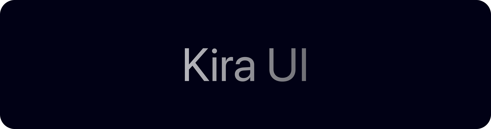
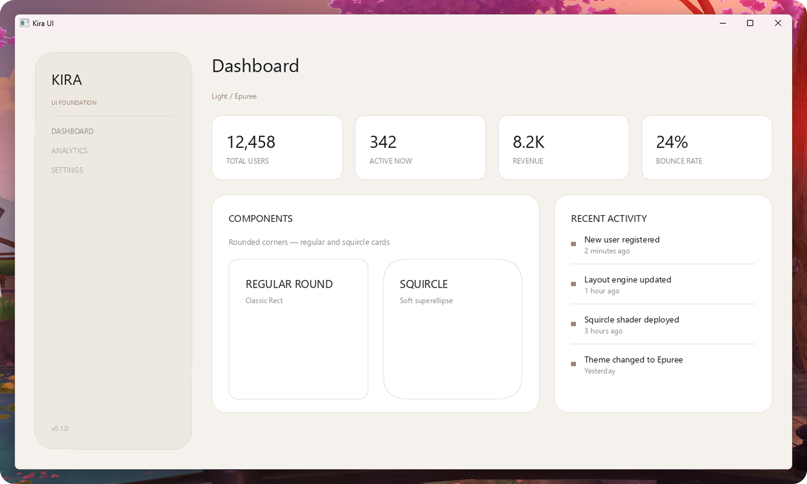

<picture>
  <source media="(prefers-color-scheme: dark)" srcset="Images/KiraUIBannerDark.png">
  <source media="(prefers-color-scheme: light)" srcset="Images/KiraUIBannerLight.png">
  
</picture>

# Kira UI

A high-level declarative widget layer for the Kira programming language. Build GPU-accelerated applications with a composable widget tree, modifier chains, and a rich material system — all in clean, readable Kira code.

```kira
import KiraUI

RunWidgetApp(
    VStack(spacing = Spacing.Medium) {
        Text("Hello, Kira UI!")
            .typography(.title)

        Card(material = Material.Frosted) {
            Text("Frosted glass card")
        }
    }
    .inset(horizontal = Spacing.Large, vertical = Spacing.Large)
)
```

Built on [Kira UI Foundation](https://github.com/kira-lang-com/ui-foundation) — a retained-tree rendering engine with identity-based reconciliation, dirty flags, and deterministic teardown — Kira UI gives you a familiar SwiftUI-like API without templates or bindings.

## Showcase

<picture>
  <source media="(prefers-color-scheme: dark)" srcset="Images/KiraUIShowcaseSundayAI.png">
  <source media="(prefers-color-scheme: light)" srcset="Images/KiraUIShowcaseSundayAI.png">
  
</picture>

[basic-demo](Examples/basic-demo) — a full app built with Kira UI demonstrating cards, frosted glass, custom surfaces, and composable widget trees.

[theme-api-showcase](Examples/theme-api-showcase) — a real construct-backed `Theme` implementation with typed global tokens and widget modifiers.

## Widgets

- **Text** — styled text with configurable size, weight, and color
- **VStack / HStack** — vertical and horizontal layouts with spacing, padding, and alignment
- **VStackFill / HStackFill / HStackStretch** — layout variants for fill or stretch modes
- **Surface** — configurable container with fill, border, radius, shape, material, and effects
- **Card** — pre-styled surface with material-aware fill, border, glow, and clip
- **AppSurface** — full-screen root surface with padding
- **Spacer** — flexible expanding space with configurable flex
- **Circle** — squircle shape primitive
- **Divider** — horizontal line separator
- **LinearGradient** — multi-strip gradient between two colors
- **Button** — focused, disabled control with local label presentation
- **NavigationStack / NavigationSplitView** — Apple-shaped path navigation
  with responsive collapse, TV sizing, and device-independent screen code

## Modifiers

Chain modifiers onto any widget for declarative customization:

| Modifier | Description |
|----------|-------------|
| `.inset(horizontal, vertical)` | A container's own inset, in spacing tokens |
| `.background(fill)` | Layer a fill widget behind content |
| `.cornerRadius(radius)` | Rounded corners with clip |
| `.blurBehind(radius, saturation)` | Glass blur effect |
| `.glow(intensity)` | Outer glow |
| `.font(size, weight)` | Text font and weight |
| `.opacity(value)` | Transparency |
| `.fill(color)` | Surface fill color |
| `.textColor(color)` | Text color |
| `.theme(theme)` / `.themeColor(color)` | Inherited theme selection and theme color |
| `.foregroundColor(color)` | Scoped control foreground |
| `.material(value)` | Scoped surface material |
| `.disabled(value)` | Environmental disabled state |
| `.focused(value)` | Isolated focus request |
| `.size(value)` / `.width(value)` / `.height(value)` | Fixed dimensions |
| `.minWidth(value)` | Minimum width |
| `.fillHeight()` | Expand to fill available height |
| `.surfaceRadius(value)` | Surface corner radius |
| `.surfacePadding(value)` | Surface inner padding |
| `.surfaceShape(shape)` | RegularRoundedRect or Squircle |
| `.surfaceBorder(color, width)` | Surface border |

## Navigation

See [Navigation.md](Navigation.md) for the responsive `NavigationPath`,
`NavigationStack`, `NavigationLink`, `NavigationRoute`, and
`NavigationSplitView` API. The layered runnable app is in
[`Examples/navigation-app`](Examples/navigation-app).

## Accessibility

See [Accessibility.md](Accessibility.md) for the elements each view makes,
the `.accessibility…` modifiers, the accessibility environment values, and
`accessibilityElementsOnScreen()`, the tree a UI test reads.

## Workspaces

Editor windows: panels docked around a center, arranged by the person.

```kira
Workspace(layout = layout, center = .AcceptsPanels) {
    Panel(value = FilesPanel(), title = "Files", systemImage = .Folder, edge = .Leading) {
        FileTree()
    }
    Panel(value = DocumentPanel(name = "rpc-node.ts"), title = "rpc-node.ts", systemImage = .DocText, edge = .Center) {
        CodeEditor()
    }
}
.toolbar {
    ToolbarItemGroup(placement = .Navigation) {
        PanelEdgeToggle(edge = .Leading)
        PanelEdgeToggle(edge = .Bottom)
        PanelEdgeToggle(edge = .Trailing)
    }
}
```

Each panel states where it starts; after that KiraUI handles the person's
changes. They can drag a tab to another edge, where a drop zone shows where
it will land. They can close a tab and bring the panel back from the strip's
`+` menu. They can drag a divider to resize an edge, or past its minimum to
fold the edge away. `WorkspaceLayout` lets the application ask what is where
and change it (`show`, `hide`, `dock`, `toggle`, `reset`). `center = .Fixed`
keeps the center to what was declared there, such as a game engine's
viewport. A runnable editor is in
[`Examples/editor-app`](Examples/editor-app).

## Interface Modes

One interface, drawn at two sizes:

- **Adaptive Desktop** (macOS, Windows, Linux) — the Mac's sizes: 13-point
  body, 28-point sidebar rows, a 52-point toolbar. Rows, sidebar items and
  pressable views light while the pointer rests on them.
- **Adaptive Mobile** (iOS, iPadOS, Android) — the iOS and iPadOS kit's sizes:
  17-point body, 44-point rows. Nothing lights on hover.

The views, their structure and their motion are the same in both. The catalog
carries both sizes: the mobile one is its floor, and the desktop one is pinned
to the desktop idiom. A program starts in its host's mode, or in the one
`KIRA_UI_MODE=desktop|mobile` sets, and can switch while it runs:

```kira
setInterfaceMode(.AdaptiveMobile)
```

## Project Structure

```text
app/
├── KiraUI.kira        # Entry points (RunWidgetApp, RunKiraApp)
├── ModifierContext.kira # Typed modifier vocabulary, deltas, and traversal context
├── Modifiers.kira     # Widget modifier extensions
└── WidgetModel.kira   # Core widgets, color system, and lowering logic
```

## Getting Started

Install the [Kira SDK](https://github.com/kira-lang-com/kira) and [Kira UI Foundation](https://github.com/kira-lang-com/ui-foundation), then:

```bash
cd Examples/basic-kira-ui-app
kira run
```

### Which `kira`

These commands want **`kk`**, the native frontend of the
[Kira Language Framework](https://github.com/kira-lang-com/klf-kira), which
`klf build .` produces in that repository. `kk`'s binary is also called `kira`,
so the two are told apart by which one is on your `PATH`, not by the name you
type.

Build with `kk`, not the oracle compiler from
[kira-lang-com/kira](https://github.com/kira-lang-com/kira). On this codebase
the oracle aborts partway through semantic analysis — `index out of bounds` in
`kira-semantics/src/analyze/scope.rs` — where `kk` compiles the same sources and
the suite passes. The oracle also refuses to resolve `Button(title:action:)` to
`Button`'s `init`, which `kk` resolves.

## Colors

Preset colors for common UI needs — White, Beige, Taupe, Green, Blue, Purple, Cyan, Yellow, plus text and border variants (DarkText, SecondaryText, MutedText, BorderSoft, MutedGreen, MutedBlue, MutedOrange).

## Materials

Surfaces and cards support three material modes:

- **Flat** — solid opaque surface
- **Frosted** — blur-behind glass effect
- **LayeredGlass** — multi-layer glass with glow

## Ecosystem

Kira UI is part of the Kira language ecosystem:

- [Kira](https://github.com/kira-lang-com/kira) — the language compiler & VM
- [Kira UI Foundation](https://github.com/kira-lang-com/ui-foundation) — retained-tree rendering foundation
- [Ember](https://github.com/kira-lang-com/kira-graphics) — GPU graphics backend
- [KiraLayout](https://github.com/kira-lang-com/kira-layout) — two-pass layout engine

## License

Apache License 2.0. See `LICENSE`.
